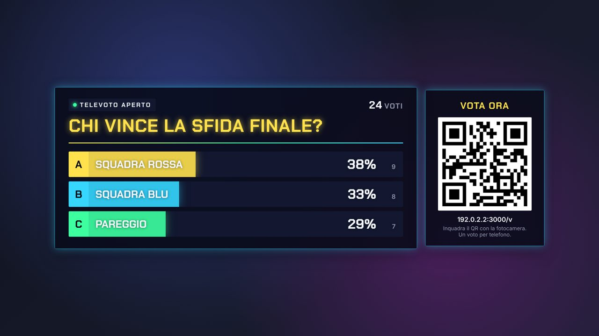
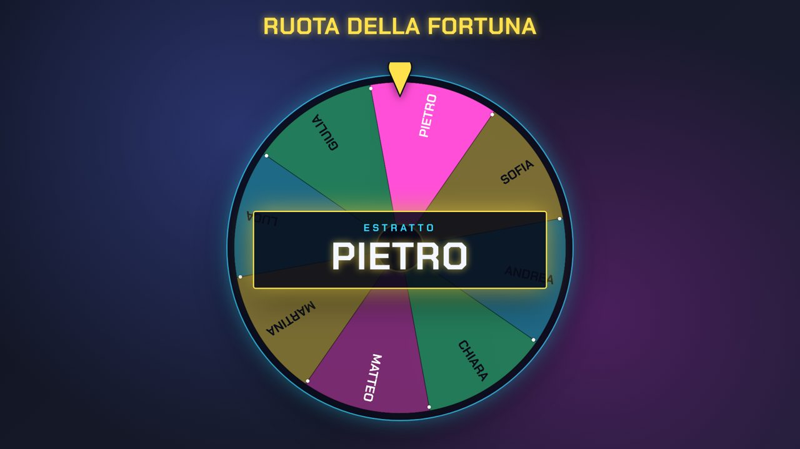
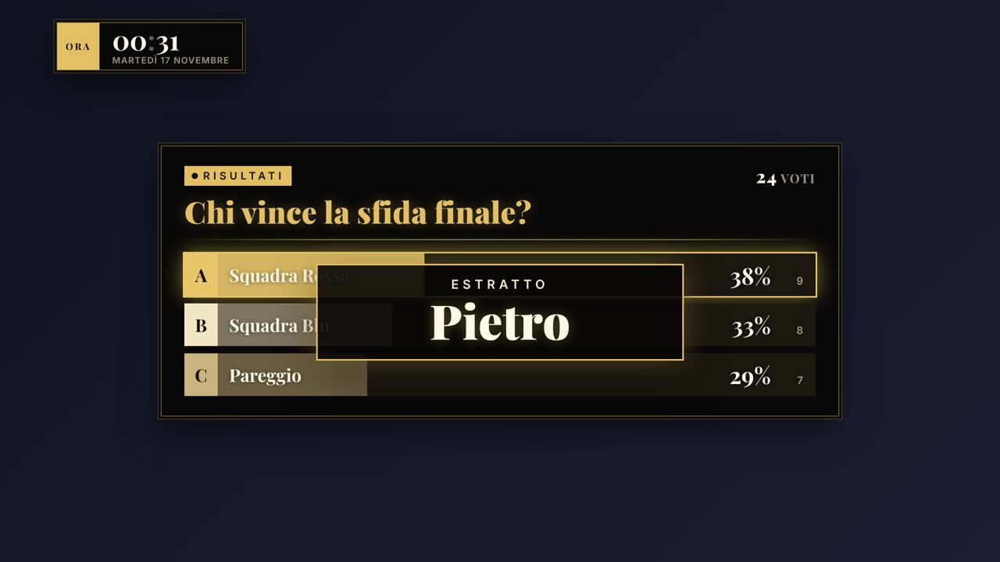
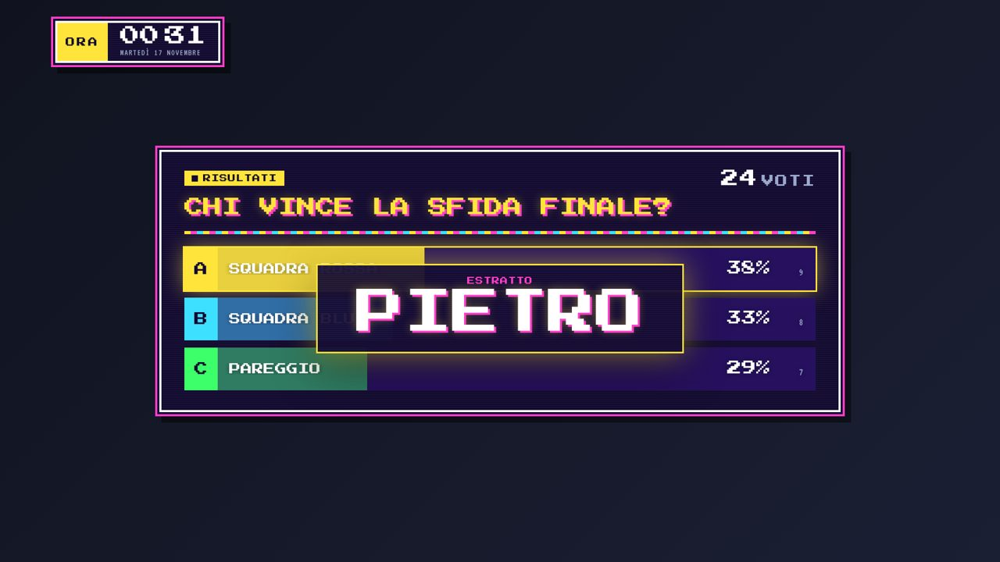
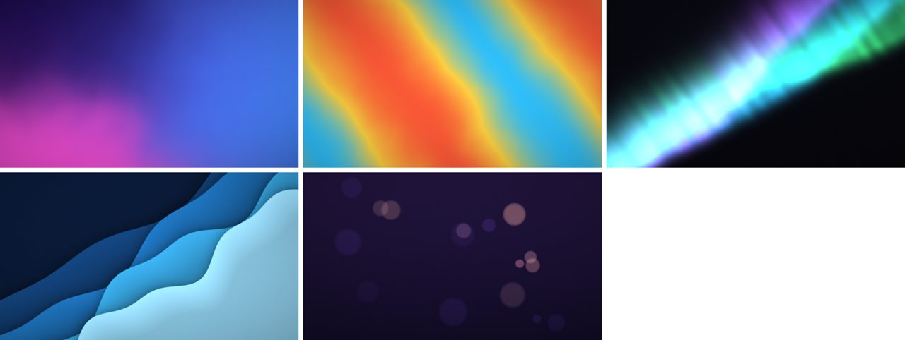
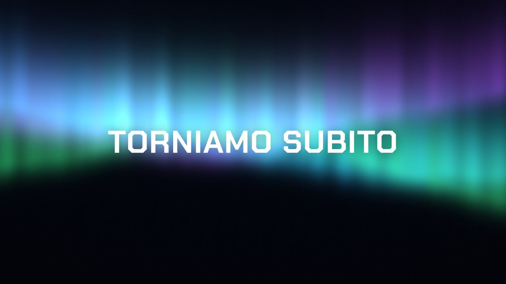

# LiveGFX

> **Versione 0.9 – beta.** Funziona, ma non è ancora stato provato in un evento vero: usalo, segnala i problemi nelle Issues e fai una prova generale prima di andare in diretta.

Grafiche live animate per OBS, aggiornabili in tempo reale da un pannello web, anche da telefono o da remoto. Gratis e open source.

| | |
|---|---|
|  |  |
|  |  |
|  |  |

☕ **Ti è utile?** LiveGFX è gratuito. Se ti ha risparmiato tempo, puoi [offrirmi un caffè](LINK-CAFFE).

**Grafiche incluse**
| Grafica | Cosa fa |
|---|---|
| Classifica | Righe che si riordinano animate, punteggi che "contano", flash verde/rosso per chi sale o scende, dorato per chi va primo. Pari merito gestiti (1, 1, 3). |
| Ospiti (lower third) | Coda di ospiti preparati + "In onda subito" per l'ultimo secondo. Se cambi ospite mentre è in onda, il vecchio esce e il nuovo entra. |
| Squadre | Tabellone 2–4 squadre, con colori, "pop" del punteggio a ogni punto. |
| Timer | Conto alla rovescia o cronometro, sincronizzato col server, pulsa rosso negli ultimi 10 s, lampeggia a fine tempo. |
| Ticker | Barra di notizie scorrevole continua. |
| Annuncio | Titolone a tutto schermo con lettere animate (es. "LA FINALE"). |
| Televoto | Domanda con 2–6 opzioni. Il pubblico vota dal telefono inquadrando il QR (un voto per telefono), oppure si vota per alzata di mano e conti tu dal pannello. Barre in diretta o risultati nascosti fino a "Rivela". |
| Quiz | Stile quiz televisivo: domanda e 4 risposte. Dal pannello "accendi" la risposta del concorrente (arancione), poi riveli: verde se è giusta, rossa se è sbagliata e la giusta lampeggia. Domande scritte a mano o generate con un'IA (prompt pronto nel pannello). |
| Ruota della fortuna | Fino a 40 spicchi (lista libera, classifica o squadre). L'estrazione la fa il server, poi la ruota gira e rallenta fino all'estratto. "Togli l'estratto" per estrazioni senza ripetizioni. |
| Sottotitoli | Sottotitoli live stile TikTok dal microfono, offline (programma in `sottotitoli/`). Pausa, posizione, dimensione e colore dal pannello. |
| Orologio | Ora del Mac, con etichetta, secondi e data facoltativi, in uno dei quattro angoli. |
| Sfondo animato | Fonte a schermo intero da mettere in fondo alla scena. 5 stili (Fluido, Scorrimento, Aurora, Onde, Bokeh), da 2 a 5 colori scelti da te, velocità, intensità, angolo, luminosità, grana. Preset salvabili. |
| Copertura | Schermo intero che entra sopra tutto (dissolvenza, tendina, zoom, cerchio) per nascondere le fonti: titolo, sottotitolo e logo caricato da te, sopra uno sfondo animato. |

Sette temi, da Impostazioni → Tema grafico, in diretta:
**Glass** (vetro liquido, glow viola, predefinito) · **Neon** (giallo · verde · azzurro) · **Clean** (chiaro, istituzionale) ·
**Cinema** (nero e oro, titoli con grazie, bande nere sugli annunci) · **Old Game** (arcade anni '80, font pixel, righe di scansione) ·
**Glitch** (verde acido e rosa, disturbi RGB) · **Personalizzato** (scegli tu colori, font, angoli, bagliore e maiuscole dal pannello).

> Nota sul tema Glass: in OBS una Browser Source non può sfocare il video che c'è sotto, quindi l'effetto vetro è ricostruito con trasparenza, riflessi e bordi luminosi (stile in `public/gfx/glass.css`). Tutto funziona **offline**: font e librerie sono già inclusi.

---

## 1. Avvio

1. Installa **Node.js LTS** da https://nodejs.org (solo la prima volta).
2. Doppio clic su **`start.command`**.
   - Se macOS lo blocca: tasto destro → *Apri* → *Apri*.
   - Se dice "permesso negato": nel Terminale `chmod +x start.command`.
3. Si apre il pannello. Nella finestra del Terminale trovi:
   - **PIN REGIA**: può fare tutto.
   - **PIN OPERATORE**: può solo aggiornare punteggi, ospiti in coda e ticker. Non decide cosa va in onda.

I PIN sono generati al primo avvio e stanno in `config.json` (puoi cambiarli e riavviare).
Lo stato dell'evento è salvato in `data/state.json`: se chiudi tutto e riapri, ritrovi classifica e squadre.

## 2. OBS

**Metodo semplice (consigliato):** una sola Browser Source con tutte le grafiche.
- Fonti → `+` → **Browser**
- URL: `http://localhost:3000/gfx/overlay.html`
- Larghezza **1920**, Altezza **1080**
- Lascia **disattivati** "Spegni la sorgente quando non visibile" e "Aggiorna il browser quando la scena diventa attiva".
- Metti la fonte **sopra** a tutto nella scena (o in una scena "Grafiche" annidata in tutte le altre).

**Metodo avanzato:** una Browser Source per grafica, così puoi metterle in scene diverse o applicare filtri separati:
`/gfx/leaderboard.html` · `/gfx/lowerthird.html` · `/gfx/scoreboard.html` · `/gfx/timer.html` · `/gfx/ticker.html` · `/gfx/announce.html`

Per provarle in un browser normale aggiungi `?bg=1` (sfondo di prova). Per forzare un tema su una sola fonte: `?theme=clean`.

Le grafiche **non** usano `file:///`: passano sempre dal server, quindi niente problemi di caricamento.

## 3. Controllo da telefono

**Stessa rete:** il Terminale mostra l'indirizzo "rete locale" (es. `http://192.168.1.20:3000/`). Aprilo sul telefono.
⚠️ Le reti scolastiche spesso isolano i dispositivi tra loro. Se il telefono non si collega, usa un router tuo o l'hotspot del telefono per Mac e telefono.

**Da remoto (altra stanza, 4G/5G, da casa):** usa **Tailscale**
1. Installa Tailscale su Mac e telefono, accedi con lo stesso account.
2. Il Terminale mostrerà un indirizzo "(Tailscale)" che inizia con `100.`: aprilo dal telefono, ovunque tu sia.
Il pannello resta privato: non è esposto su internet.

Il pannello ha un pallino verde/rosso in alto: rosso = connessione persa (si ricollega da solo).

## Televoto: cosa serve davvero

**Due modi di far arrivare il pubblico alla pagina di voto:**

1. **Online (consigliato)**: pannello → Televoto → **Attiva voto online**. LiveGFX avvia un tunnel Cloudflare gratuito (niente account) e ottiene un indirizzo `https://….trycloudflare.com`: può votare chiunque, anche con i dati mobili. Il QR a schermo si aggiorna da solo.
   - La prima volta scarica `cloudflared` (circa 20 MB) nella cartella `bin/`. Se l'hai già installato con Homebrew, usa quello.
   - **L'indirizzo cambia a ogni attivazione**: attivalo prima dell'evento e lascialo acceso.
   - **Solo la pagina di voto è online.** Il tunnel porta a un server separato (porta 3001, solo su questo Mac) che risponde esclusivamente alla pagina di voto: pannello, grafiche e API restano raggiungibili solo in rete locale.
   - **Il traffico passa dalla connessione internet del Mac** (Cloudflare fa da tramite, non ospita nulla). La pagina è fatta per consumare poco: controlla spesso solo a votazione aperta, rallenta dopo il voto, si ferma a schermo spento, e se non è cambiato nulla riceve una risposta vuota.
   - Limiti del servizio gratuito di Cloudflare: nessuna garanzia di funzionamento continuo, massimo 200 richieste contemporanee (con i controlli leggeri della pagina, centinaia di telefoni restano molto sotto).
2. **Rete locale**: `http://<ip-del-mac>:3000/v`, solo per chi è sulla stessa rete del Mac. Funziona anche senza internet. Molte reti scolastiche isolano i dispositivi tra loro: lì non va.

**Prova sempre prima** dal tuo telefono con i dati mobili (Wi-Fi spento), inquadrando il QR in Televoto → Opzioni televoto.

**Un voto per telefono**: al primo accesso il telefono riceve un cookie casuale; il server ricorda chi ha votato (`data/ballots.json`, sopravvive ai riavvii). Non è a prova di furbo: chi cancella i cookie o usa una finestra anonima può rivotare. Per bloccarlo davvero servirebbe un login.

**Limite di votanti**: predefinito **300**, modificabile (1–2000). Raggiunto il limite, i nuovi telefoni vedono "numero massimo raggiunto".

**Alzata di mano**: scegli "Alzata di mano" quando prepari la votazione; nel pannello compaiono −1 / +1 / +5 / Imposta per ogni opzione. Non serve nessuna rete: è anche il piano B del televoto.

## Sfondi animati e copertura

- **Sfondo**: in OBS aggiungi una Browser Source `http://localhost:3000/gfx/background.html` (1920×1080) **in fondo** alla scena. Segue lo sfondo scelto nel pannello, scheda **Sfondi**; i cambi di colore sono morbidi, il cambio di stile fa una dissolvenza.
- **Sfondi diversi in scene diverse**: salva un preset (es. "Pausa") e usa `…/gfx/background.html?preset=Pausa`: quella fonte resta sempre su quel preset.
- **Copertura**: è l'ultimo livello dell'overlay unico. Se in OBS hai fonti sopra l'overlay, aggiungi `/gfx/cover.html` come fonte separata **in cima** alla scena. "Nascondi tutto" non la tocca, apposta.
- **Logo**: caricalo dal pannello (PNG con trasparenza ideale, max 5 MB); finisce in `data/uploads/`.
- **Prestazioni**: gli sfondi sono disegnati dalla scheda grafica (WebGL) a 30 fotogrammi al secondo; la copertura non calcola nulla quando non è in onda. Per più fluidità: `?fps=60` nell'indirizzo. In OBS lascia attiva l'accelerazione hardware delle Browser Source (è il valore predefinito).

## Regia OBS dal telefono (Stream Deck integrato)

La scheda **🎛️ OBS** del pannello comanda OBS a distanza: scene con miniature dal vivo, transizione, audio e tasti macro.

**Collegamento (una volta sola):** in OBS → *Strumenti → Impostazioni server WebSocket* → spunta **Abilita server WebSocket** → *Mostra informazioni di connessione* → copia la password. Nel pannello → scheda OBS → *Collegamento a OBS* → incolla la password → **Salva e collega**. Da quel momento LiveGFX si ricollega da solo ogni volta che apri OBS. La password resta in `data/obs.json` sul Mac.

- **Scene**: tocchi una scena e va in **anteprima** (bordo verde), poi **TRANSIZIONE** la manda **in onda** (bordo rosso). Se la modalità studio di OBS è spenta, la scena va subito in onda (c'è un pulsante per accenderla). Transizione e durata si scelgono sotto.
- **Audio**: muto/attivo e volume (in dB, come il mixer di OBS) di ogni fonte con audio.
- **Tasti macro** (*✎ Modifica*, solo PIN regia): un tasto esegue più passi in fila. Passi possibili: scena in onda o in anteprima, transizione, muto/attiva/inverti un audio, una grafica LiveGFX (mostra/nascondi, quiz, timer, televoto, ruota…), un annuncio con testo, attesa di N secondi. Esempio "Via al quiz": scena *Quiz* in anteprima → transizione → mostra quiz → attendi 1 s → avvia tempo.
- **Chi può fare cosa**: l'operatore usa scene, transizione, audio e tasti; solo la regia modifica i tasti e il collegamento.
- **Solo rete locale**: la regia OBS funziona dal pannello sulla rete del Mac (Wi-Fi o hotspot). Dal tunnel internet passa solo la pagina di voto.
- Le miniature si aggiornano solo mentre la scheda OBS è aperta (in onda e anteprima ogni secondo, le altre a rotazione), così OBS non lavora per niente.

## Quiz

1. Pannello → scheda **Quiz**. Scrivi le domande a mano (domanda, 4 risposte, pallino sulla giusta) oppure apri **Genera un set con l'IA**: argomento, quante domande, difficoltà, pubblico → **Copia il prompt** → incollalo in Claude, ChatGPT o Gemini → incolla qui la risposta → **Sostituisci il set** (o **Aggiungi in fondo**).
2. **Controlla le risposte giuste** nell'elenco: le IA a volte sbagliano. La ✓ verde la vedi solo nel pannello, mai in onda.
3. **IN ONDA** → il concorrente risponde → tocchi la sua risposta ("la accendiamo?") → **Rivela la risposta** → **Prossima**. Se nessuno risponde, "Rivela" mostra solo la giusta. **Rifai la domanda** azzera la domanda corrente.

**Punti, aiuti e spettacolo**
- **Chi risponde**: scegli il concorrente dal menu (sono i partecipanti della Classifica). Se la risposta è giusta, alla rivelazione i punti vanno in classifica da soli (default 10, in *Opzioni quiz*). "Rifai la domanda" li toglie.
- **🏆 Ultima domanda**: scritta "ULTIMA DOMANDA" a tutto schermo, poi la domanda con cornice dorata. Vale **punti doppi**.
- **✂️ 50:50**: toglie due risposte sbagliate (una volta per domanda).
- **Timer**: in *Opzioni quiz* accendilo e scegli i secondi. Parte da solo quando entra la domanda, si ferma quando accendi una risposta, tic-tac negli ultimi 5 secondi.
- **Suoni**: generati dal browser, cambiano col tema (classico, arcade, cinema, digitale, telegiornale, giocoso). Un tema può sceglierli con `--qz-sound: arcade;` nel suo CSS. In OBS, nella fonte, attiva **"Controlla l'audio tramite OBS"**. Volume e muto in *Opzioni quiz*. Se usi sia l'overlay unico sia `/gfx/quiz.html`, aggiungi `?mute=1` a una delle due per non sentire i suoni doppi.

Altro: **Esporta set** / **Importa set** (file `.json`, utile per preparare i quiz prima), **Mescola le risposte** (la giusta resta giusta), titolo in onda e numero della domanda in *Opzioni quiz*. L'operatore (PIN operatore) può condurre il quiz ma non modificare le domande. Fonte da sola: `/gfx/quiz.html`.

Formato del file (lo stesso che chiede il prompt all'IA):
```json
{"titolo":"Cinema italiano","domande":[
  {"domanda":"Chi ha diretto \"La dolce vita\"?","risposte":["Antonioni","Fellini","Visconti","De Sica"],"corretta":"B","spiegazione":"Federico Fellini, 1960."}
]}
```
Limiti: domanda 160 caratteri, risposte 70, massimo 200 domande. Le domande incomplete vengono scartate.

## Sottotitoli

1. Avvia LiveGFX come sempre.
2. Doppio clic su `sottotitoli/start.command` (la prima volta scarica il modello italiano, circa 50 MB, poi è tutto offline).
3. Nel pannello, scheda **Sottotitoli**: il pallino verde dice che il programma è collegato. Premi **VAI IN ONDA**.

La grafica è già dentro l'overlay unico (o da sola: `/gfx/subtitles.html`). **Pausa** dal pannello o tasto P nel Terminale: sottotitoli fermi e niente trascrizione (utile durante video o musica). La trascrizione completa finisce in `sottotitoli/trascrizioni/`, pronta da far riassumere a un'IA. Le parole riconosciute male si correggono in `sottotitoli/correzioni.txt`.
Opzioni: `./start.command --microfoni` (elenco), `--microfono 2` (sceglie il microfono), `--demo` (prova senza microfono).

## 4. API per pulsanti fisici, Stream Deck, ESP32, giochi

Ogni comando del pannello è anche una chiamata HTTP:

```
POST http://<ip-del-mac>:3000/api/action
Content-Type: application/json
X-Pin: 123456

{"type": "sb.score", "id": "<id squadra>", "delta": 1}
```

Gli `id` li trovi in `GET /api/state`.
Esiste anche la forma `GET /api/action?pin=…&type=all.hide`, comoda per i test, ma il PIN finisce nell'indirizzo: per pulsanti fissi preferisci il POST con l'header `X-Pin`.

Comandi principali:

| Comando | Parametri |
|---|---|
| `all.hide` | nasconde tutto (pulsante panico) |
| `lb.show` / `lb.hide` | |
| `lb.add` | `name`, `sub`, `score` |
| `lb.score` | `id`, `delta` |
| `lb.update` | `id`, `name`, `sub`, `score` |
| `lt.quick` | `name`, `role`, `tag` (in onda subito) |
| `lt.queue.add` / `lt.take` | ospite in coda / manda in onda `id` |
| `lt.hide` | |
| `sb.show` / `sb.hide` / `sb.score` | `id`, `delta` |
| `timer.start` / `timer.pause` / `timer.reset` / `timer.add` | `delta` in ms |
| `timer.config` | `label`, `mode` (`countdown`/`stopwatch`), `duration` ms |
| `tk.set` | `items` (array), `label`, `speed` |
| `an.show` / `an.hide` | `kicker`, `title`, `subtitle` |
| `theme.set` | `value`: `glass` / `neon` / `clean` / `cinema` / `oldgame` / `glitch` / `custom` |
| `theme.custom` | `accent`, `accent2`, `accent3`, `panel`, `text`, `textOnAccent` (colori `#RRGGBB`), `panelAlpha`, `radius`, `glow`, `font`, `uppercase` |
| `vote.setup` | `question`, `options` (array), `mode` (`phone`/`hands`) |
| `vote.open` / `vote.close` / `vote.reveal` / `vote.reset` / `vote.show` / `vote.hide` | |
| `vote.hands` / `vote.handsSet` | `id`, `delta` / `id`, `value` (alzata di mano) |
| `vote.config` | `reveal` (`live`/`final`), `showQr`, `maxVoters`, `joinUrl` |
| `tunnel.start` / `tunnel.stop` | voto online on/off (solo PIN regia) |
| `quiz.show` / `quiz.hide` / `quiz.next` / `quiz.prev` / `quiz.goto` | – / `index` (da 0) per `goto` |
| `quiz.select` / `quiz.unselect` / `quiz.reveal` | `answer` 0–3 (A–D) per `select`; `unselect` spegne o rifà la domanda |
| `obs.preview` / `obs.program` | `scene` (nome della scena in OBS) — `preview` senza modalità studio va in onda |
| `obs.transition` / `obs.studio` | – / `on` true/false |
| `obs.mute` / `obs.volume` | `input` (nome fonte) + `on` (vuoto = inverti) / `input` + `mul` 0–1 |
| `obs.macro` | `id` del tasto macro |
| `quiz.contestant` / `quiz.fifty` / `quiz.final` / `quiz.timerStart` / `quiz.timerStop` | `id` del partecipante (vuoto = nessuno) / – |
| `quiz.config` | `title`, `showNumber`, `points`, `timerOn`, `timerSec`, `volume` (0–100), `muted` |
| `quiz.set` / `quiz.append` / `quiz.add` / `quiz.update` / `quiz.remove` / `quiz.move` / `quiz.shuffle` / `quiz.clear` | `questions` (array come sopra) / campi della domanda / `id` / `id`+`dir` (`up`/`down`) |
| `wheel.add` / `wheel.remove` / `wheel.clear` / `wheel.import` | `items` (array) / `id` / – / `source` (`leaderboard`/`teams`) |
| `wheel.spin` / `wheel.removeWinner` / `wheel.show` / `wheel.hide` | `duration` in ms (3000–15000) |
| `subs.show` / `subs.hide` / `subs.pause` / `subs.resume` / `subs.clear` | |
| `subs.config` | `position`, `words`, `size`, `hideAfter`, `highlight` |
| `clock.show` / `clock.hide` / `clock.config` | `label`, `seconds`, `date`, `position` |
| `bg.set` | `style` (`fluid`/`scroll`/`aurora`/`waves`/`bokeh`), `colors` (2–5 `#RRGGBB`), `speed`, `intensity`, `angle`, `brightness`, `grain` |
| `bg.presetSave` / `bg.presetLoad` / `bg.presetDelete` | `name` / `id` / `id` |
| `cover.show` / `cover.hide` / `cover.config` | `title`, `subtitle`, `look` (`bg` o id preset), `transition` (`fade`/`wipe`/`zoom`/`iris`), `showLogo` |

Esempio ESP32 (Arduino) — un pulsante che dà +1 alla squadra A:

```cpp
#include <WiFi.h>
#include <HTTPClient.h>
void piuUno() {
  HTTPClient http;
  http.begin("http://192.168.1.20:3000/api/action");
  http.addHeader("Content-Type", "application/json");
  http.addHeader("X-Pin", "123456");
  http.POST("{\"type\":\"sb.score\",\"id\":\"ID_SQUADRA_A\",\"delta\":1}");
  http.end();
}
```

## 5. Personalizzare

- **Colori e font**: il modo più semplice è il tema Personalizzato dal pannello. Nel codice: `public/gfx/common.css` (variabili dei temi in cima al file), `glass.css` (vetro), `themes.css` (Cinema, Old Game, Glitch, Personalizzato).
- **Posizioni e animazioni**: ogni grafica è un file in `public/gfx/`. Le animazioni usano GSAP: cerca `gsap.timeline()`.
- **Elementi creati in Cavalry**: esporta un video con trasparenza (ProRes 4444), convertilo in WebM con
  `ffmpeg -i in.mov -c:v libvpx-vp9 -pix_fmt yuva420p -b:v 4M out.webm`, mettilo in `public/assets/` e inseriscilo nella grafica con `<video src="../assets/out.webm" autoplay muted loop>`.

## Temi: crea, salva, esporta, importa

Tutto dal pannello, scheda **Impostazioni**, senza toccare il codice:

- **Crea**: apri "🎨 Tema personalizzato", scegli colori, font, angoli, bagliore. Le grafiche cambiano mentre muovi i cursori.
- **Salva tra i miei temi**: gli dai un nome e diventa un tema a sé nel menu "Tema grafico" (gruppo *I miei temi*). Il Personalizzato resta libero per il prossimo.
- **Esporta come file**: scarica `nome.livegfx-theme.json`, da tenere come copia o da passare a qualcuno.
- **Importa**: carica un file `.json` esportato da LiveGFX **oppure** un file `.css` scritto a mano o da un'IA (vedi sotto).
- **I miei temi**: per ognuno *Usa*, *Modifica* (riporta i valori nell'editor, solo per i temi creati con l'editor), 📤 *Esporta*, ✕ *Elimina*.

I temi importati stanno in `data/themes/`, uno per file, e le grafiche li caricano da `/themes/user.css`: il codice che già funziona non viene mai modificato. Per sicurezza, all'importazione LiveGFX toglie `@import` e immagini prese da internet (le grafiche devono funzionare offline). Un tema importato con lo stesso nome interno di uno esistente lo sostituisce.

### Creare un tema con l'IA

Un'IA (Claude, ChatGPT, Gemini…) può scrivere un tema completo in CSS, anche con dettagli che l'editor non ha (bordi particolari, linee decorative, animazioni). Copia il prompt, sostituisci le parti tra `[parentesi quadre]` e **allega** `public/gfx/common.css`, `public/gfx/themes.css` e `public/gfx/vote.html`, così il modello vede come sono fatti i temi esistenti.

```text
Sto lavorando a LiveGFX, un progetto open source di grafiche live per OBS
(HTML/CSS/JavaScript, animazioni con GSAP). Ti allego common.css, themes.css
e vote.html. Voglio un NUOVO TEMA grafico, da importare dal pannello come
file .css, senza modificare il codice del progetto.

Il tema:
- Nome interno (minuscolo, solo lettere, numeri e trattini): [es. vaporwave]
- Nome da mostrare nel pannello: [es. Vaporwave]
- Atmosfera e riferimenti: [descrivi lo stile, es. "anni '90, griglie al neon,
  tramonto rosa, cromature"]
- Colori: [elenca i colori in #RRGGBB, oppure "scegli tu"]
- Font dei titoli: [uno della libreria inclusa, già offline: Inter, Chakra Petch,
  Playfair Display, Press Start 2P, VT323, Barlow Condensed, DM Serif Display,
  Exo 2, Oswald, Bowlby One, Righteous, Special Elite, Limelight, Cinzel,
  Black Ops One, Orbitron, Bangers, Fredoka, Alfa Slab One, Cormorant Garamond,
  Monoton, Space Grotesk, Audiowide, Quicksand, Bebas Neue, Bodoni Moda, Lexend,
  Permanent Marker, Michroma, Stardos Stencil, Grenze Gotisch]
- Angoli: [squadrati / leggermente arrotondati / molto arrotondati]
- Bagliori: [nessuno / leggeri / forti]

Come funzionano i temi in LiveGFX:
- Ogni tema è un blocco [data-theme="nome-interno"] che ridefinisce le
  variabili CSS di common.css: --yellow --green --cyan --magenta --orange
  --white, --accent --accent-2 --accent-3, --danger, --panel --panel-2, --line,
  --text --text-dim --text-on-accent, --glow, --accent-glow --accent2-glow
  --accent2-edge, --radius, --font-display --font-body, --display-case
  (uppercase o none), --subs-font --subs-case (sottotitoli).
- Dopo le variabili si aggiungono ritocchi mirati, sempre preceduti da
  [data-theme="nome-interno"], come fanno Cinema, Old Game e Glitch in
  themes.css.
- Elementi principali da curare: .neon-edge (bordo dei pannelli), .glow-accent,
  .display, .head::after, #tk::before e .question::after (linee decorative),
  .bar (barra del lower third), .tag e .label, classifica (#board .row .rank
  .name .score), squadre (.tname .tscore), timer (#tm .time), ticker (#tk .item
  .sep), annuncio (#an .title .kicker .subtitle .backdrop), televoto (.opt
  .letter .fill .pct .status #qr), orologio (#ck), ruota (#wh .title, #win .box),
  sottotitoli (.p, #blocco), copertura (.content .title .subtitle).

Regole da rispettare:
1. Un solo file CSS. Prima riga: /* LiveGFX tema: Nome da mostrare */
   Ogni regola deve iniziare con [data-theme="nome-interno"].
2. Niente risorse da internet: niente @import, niente url() verso siti web,
   niente font esterni (verrebbero tolti all'importazione). Usa solo i font
   elencati sopra, scritti esattamente così (es. font-family: 'Cinzel');
   effetti e texture solo con gradienti CSS.
   Usa il font decorativo solo per i titoli (--font-display): le etichette
   piccole (.tag .label .live .kicker) lasciale in 'Inter', altrimenti a 20 px
   non si leggono.
3. Le animazioni CSS NON devono usare transform: GSAP anima già quegli elementi
   e ci sarebbero conflitti. Usa solo clip-path, opacity, text-shadow, filter,
   background-position.
4. Testi leggibili su video compresso: contrasto alto, niente testo sottile su
   sfondi chiari, niente dettagli più piccoli di 2 px.
5. Deve funzionare nella Fonte browser di OBS (Chromium): niente funzioni CSS
   sperimentali.
6. Se il font è molto largo (come Press Start 2P), riduci le dimensioni dei
   testi come fa il tema Old Game.

Dammi il file CSS completo in un unico blocco, poi spiegami in breve le scelte
principali.
```

**Dopo**: salva la risposta in un file `nome.css`, poi nel pannello **Impostazioni → I miei temi → Importa**. Il tema compare subito nel menu "Tema grafico". Controllalo con l'anteprima 👁 mandando in onda più grafiche insieme, e fai una prova in OBS prima di usarlo in diretta. Se qualcosa non va, correggi il file e reimportalo: sostituisce il precedente.

Ti è venuto bene? Proponilo al progetto con una Pull Request (file in `temi-community/` più uno screenshot).

## Struttura

```
server.js           server: file, WebSocket, API, PIN
lib/state.js        tutte le azioni e i dati dell'evento
lib/tunnel.js       voto online (tunnel Cloudflare)
lib/themes.js       temi salvati, esportati e importati
public/gfx/bgrender.js  motore WebGL degli sfondi animati
bin/cloudflared     scaricato da solo al primo voto online
public/gfx/         le grafiche per OBS
public/panel/       il pannello di regia
public/vote/        la pagina di voto per i telefoni del pubblico
public/vendor/      GSAP, generatore QR, font (offline)
sottotitoli/        programma Python dei sottotitoli (Vosk, offline)
data/state.json     stato salvato (creato da solo)
data/ballots.json   chi ha già votato (creato da solo)
data/uploads/       logo della copertura
data/themes/        temi salvati e importati dal pannello
config.json         porta e PIN (creato da solo)
```

Licenza MIT per il codice di LiveGFX. I componenti di terze parti (GSAP, font, generatore QR, Vosk, cloudflared) hanno le loro licenze: vedi [THIRD_PARTY_NOTICES.md](THIRD_PARTY_NOTICES.md).

## Sostieni il progetto

LiveGFX è e resterà gratuito. Se lo usi per i tuoi eventi e vuoi ringraziare, [offrimi un caffè](LINK-CAFFE) ☕. Segnalare bug e proporre idee nelle Issues aiuta altrettanto.
